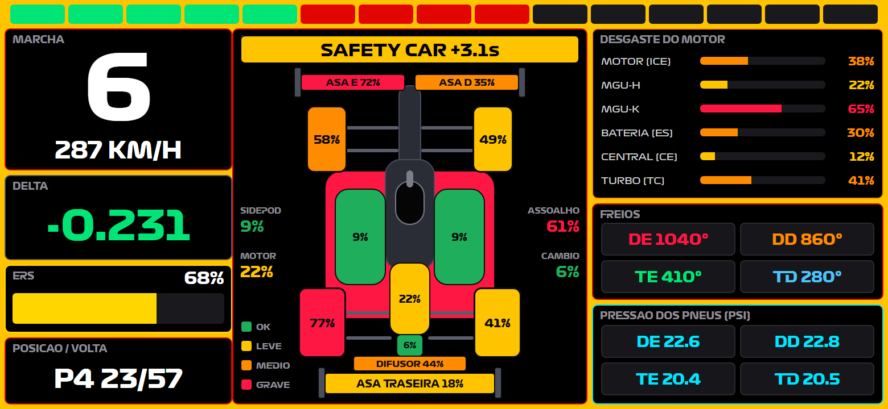
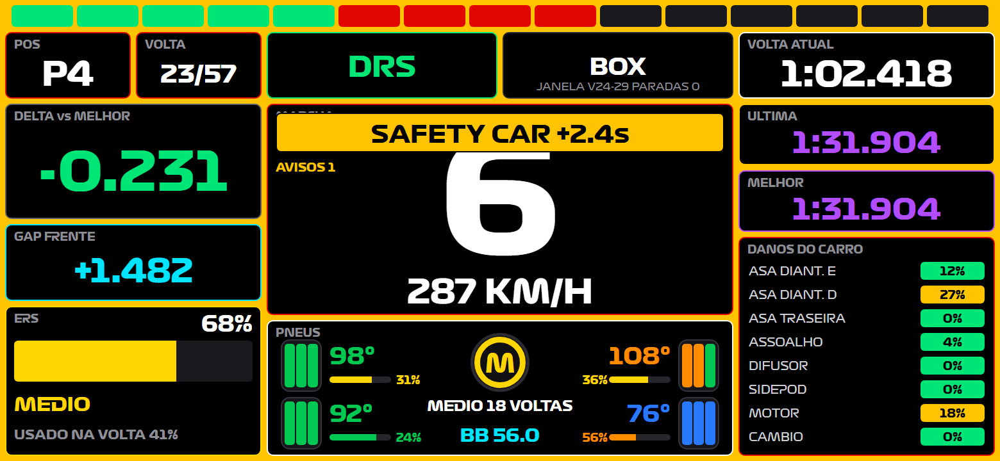
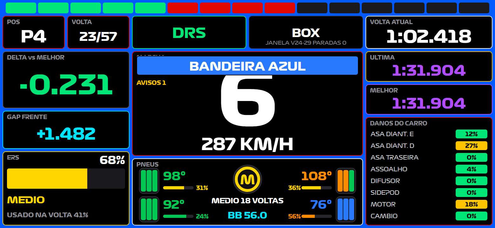
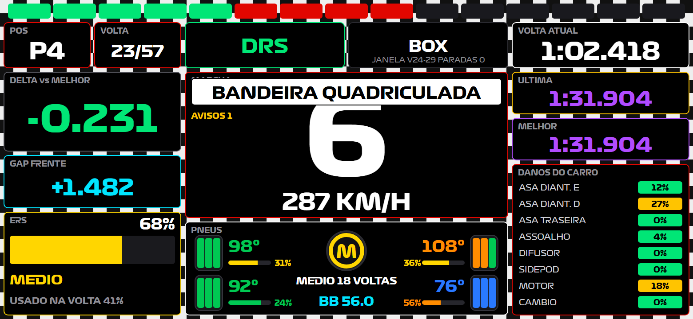
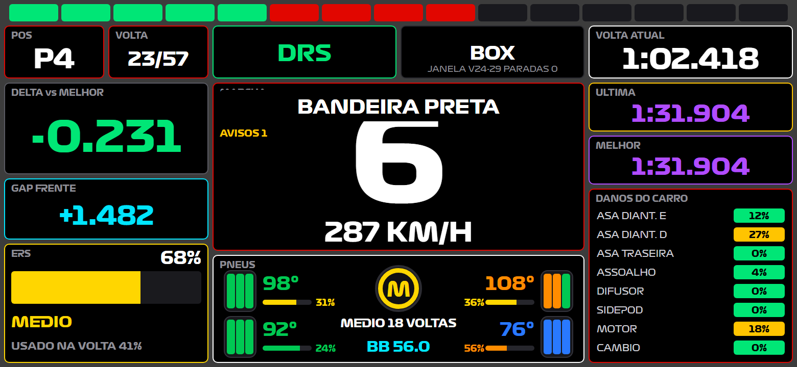
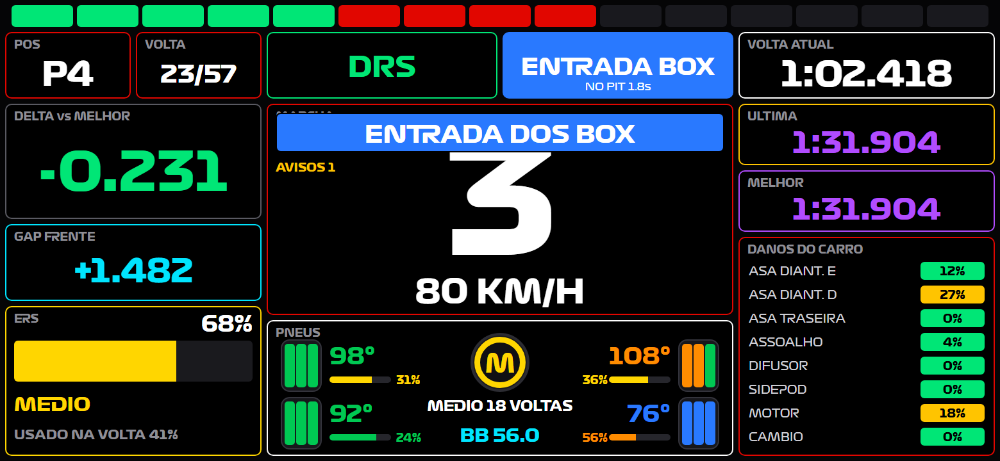
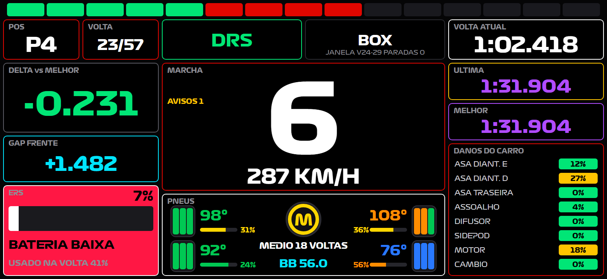
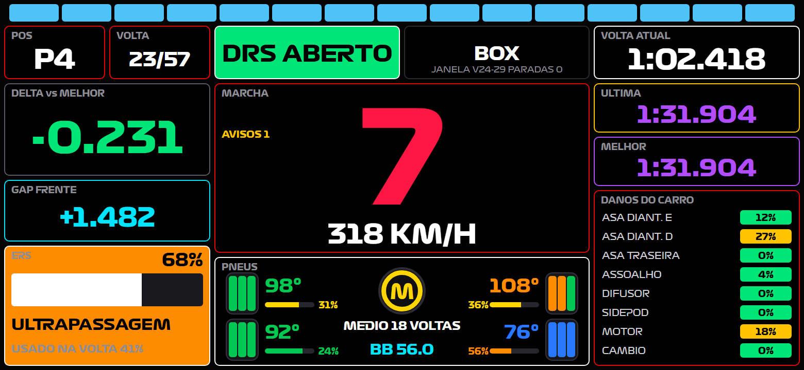
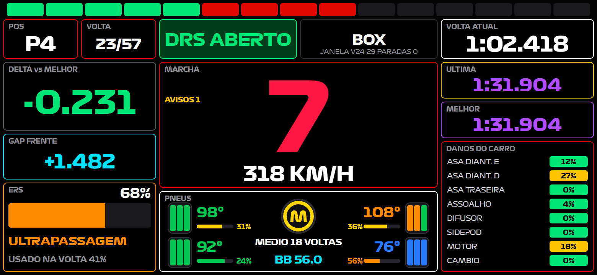
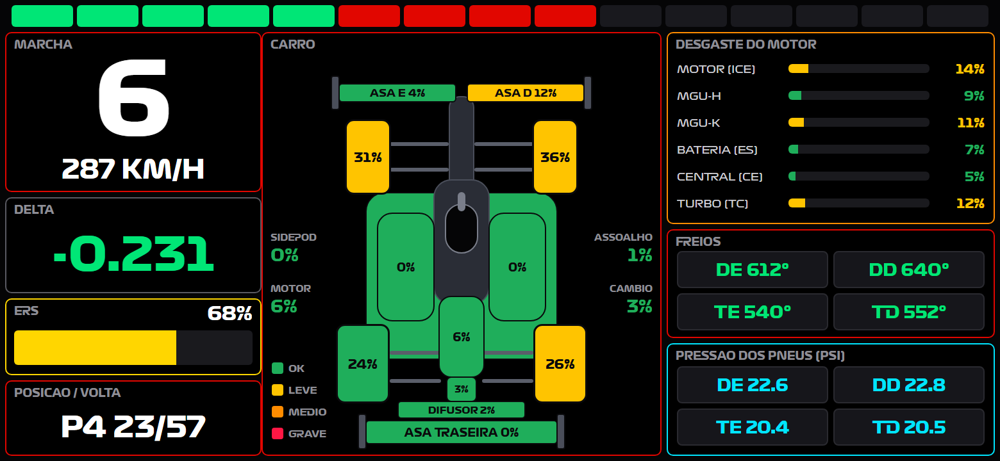

# F1 25 - Rafa Pro · Dashboard para SimHub

Dashboard para **F1 25** no **SimHub (Dash Studio)**, feita para ficar em tela cheia num **iPhone 15** (proporção 19.5:9, base 1560×720). Também funciona em tablet, segundo monitor ou qualquer tela deitada.


## Download

Baixe o arquivo **[`F1 25 - Rafa Pro.simhubdash`](F1%2025%20-%20Rafa%20Pro.simhubdash)** e dê dois cliques com o SimHub instalado.

## O que tem

### Tela 1 – Corrida
- **LEDs de RPM** (15), usando as luzes de troca do próprio jogo. Piscam azul na hora de trocar.
- **Marcha gigante.** O número fica **vermelho** quando é hora de trocar.
- **Delta vs melhor volta:** verde quando você está mais rápido, vermelho quando está mais lento.
- **Gap para o carro da frente.** Mostra "LIDER" quando você está em primeiro.
- **ERS** em amarelo, com o modo e o quanto foi usado na volta.
  - Pisca **laranja** no modo ultrapassagem.
  - Pisca **vermelho** com a bateria abaixo de 10%.
- **DRS:**
  - Mostra a distância até a zona ("DRS 120m").
  - Fica verde quando está disponível.
  - **Pisca forte** quando está aberto.
  - Avisa falha.
- **BOX:**
  - Janela de parada e número de paradas.
  - "BOX BOX" quando você está dentro da janela.
  - **Entrada dos box**, limitador, aviso "LIMITADOR!" se ele estiver desligado no pit, e timer do pit e da parada.
- **Pneus:**
  - Temperatura de fora, do meio e de dentro de cada pneu.
  - Desgaste com barra.
  - Composto (S/M/H/I/W) e voltas no jogo de pneus.
  - Brake bias.
- **Tempos:** volta atual (fica vermelha se a volta for invalidada), última e melhor (roxo).
- **Danos do carro** em lista.
- **Avisos de limite de pista** e **penalidades** (tempo, drive through, stop & go).

### Tela 2 – Carro


- **Desenho do carro** em que cada peça muda de cor conforme o dano: asas, assoalho, difusor, sidepods, motor, câmbio e os 4 pneus pelo desgaste.
- **Desgaste do motor:** ICE, MGU-H, MGU-K, bateria, eletrônica e turbo.
- **Temperatura dos freios** e **pressão dos pneus**.
- Marcha, delta, ERS e posição, para continuar correndo nessa tela.

### Bandeiras e Safety Car (nas duas telas)
O fundo da dash **pulsa** com a cor da situação, e aparece uma faixa em cima da marcha.

| | |
|---|---|
| **Safety Car** (com delta para o SC)<br> | **Virtual Safety Car**<br> |
| **Bandeira vermelha**<br> | **Bandeira amarela**<br> |
| **Bandeira azul**<br> | **Bandeira verde**<br> |
| **Bandeira quadriculada**<br> | **Bandeira preta**<br> |
| **Volta de formação**<br> | |

## Todos os modos

| | |
|---|---|
| **Corrida normal**<br> | **Entrada dos box**<br> |
| **Limitador, DRS aberto, penalidade e volta invalidada**<br> | **Bateria baixa** (pisca vermelho)<br> |
| **DRS aberto + ERS ultrapassagem + troca de marcha** (fase A da piscada)<br> | **Mesma situação** (fase B da piscada)<br> |
| **Tela do carro**<br> | **Tela do carro com danos + Safety Car**<br> |

> As imagens são prévias estáticas. No jogo, o fundo das bandeiras pulsa, e o DRS, o ERS e o box piscam alternando entre as duas fases.

## Como instalar

1. **No F1 25:** abra Configurações → Telemetria e deixe assim:
   - Telemetria UDP: **Ligada**
   - IP: `127.0.0.1`
   - Porta: `20777`
   - Formato UDP: **2025**
   - Taxa de envio: **60 Hz**
2. **No SimHub:** escolha o jogo **F1 25**.
3. Dê dois cliques em `F1 25 - Rafa Pro.simhubdash` para importar.
4. **No iPhone:** abra `http://IP-DO-SEU-PC:8888` no Safari, na mesma rede Wi-Fi, e deixe o celular deitado.
   - Dica: use Compartilhar → **Adicionar à Tela de Início** para abrir em tela cheia.

### Trocar de tela
- **No volante:** no SimHub, vá em **Controls and events**, crie um mapeamento com a ação do Dash Studio de **próxima tela** e escolha um botão.
- **No iPhone:** toque na tela para aparecerem os controles de navegação.

## Personalizar

A dash é gerada pelo script [`gerar_dash.ps1`](gerar_dash.ps1). Lá dá para mudar cores, posições e textos. Depois é só rodar:

```powershell
powershell -ExecutionPolicy Bypass -File gerar_dash.ps1
```

O script instala a dash na pasta do SimHub e gera o `.simhubdash` de novo.

As imagens de prévia são geradas por [`ferramentas/render_preview.ps1`](ferramentas/render_preview.ps1), que usa o Microsoft Edge em modo headless.

## Observações

- As cores e os textos dependem dos dados que o F1 25 manda pela telemetria. Se algum campo ficar vazio, abra uma issue.
- Usa as fontes de F1 que já vêm com o SimHub.
- Projeto de fã, sem ligação com a Formula 1, a EA ou a Codemasters.
