# F1 25 - Rafa Pro · Dashboard para SimHub

Dashboard para **F1 25** no **SimHub (Dash Studio)**, feita para ficar em tela cheia num **iPhone 15** (proporção 19.5:9, base 1560×720). Também funciona em tablet, segundo monitor ou qualquer tela deitada.

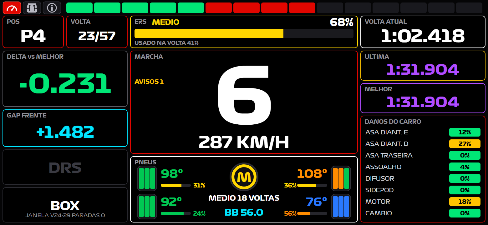

## Download

Baixe o arquivo **[`F1 25 - Rafa Pro.simhubdash`](F1%2025%20-%20Rafa%20Pro.simhubdash)** e dê dois cliques com o SimHub instalado.

## O que tem

### Tela 1 – Corrida
- **LEDs de RPM** (15), usando as luzes de troca do próprio jogo.
- **Marcha gigante com animação:**
  - Ao subir, o número cresce com um toque verde.
  - Ao reduzir, ele encolhe com um toque laranja.
  - Fica **vermelho** quando é hora de trocar.
- **Delta vs melhor volta:** verde quando você está mais rápido, vermelho quando está mais lento.
- **Gap para o carro da frente.** Mostra "LIDER" quando você está em primeiro.
- **ERS** em amarelo, sem piscar. A barra desce conforme você gasta a bateria. Mostra o modo e o quanto foi usado na volta.
- **DRS:** fica apagado e **acende verde** quando abre. Também avisa falha.
- **BOX:**
  - Janela de parada e número de paradas.
  - "BOX BOX" quando você está dentro da janela.
  - **Entrada dos box**, limitador, aviso "LIMITADOR!" se ele estiver desligado no pit, e timer do pit e da parada.
- **Pneus:**
  - Temperatura de fora, do meio e de dentro de cada pneu.
  - Desgaste com barra.
  - Composto (S/M/H/I/W) e voltas no jogo de pneus.
  - Brake bias.
- **Tempos:** volta atual (fica vermelha se a volta for invalidada), última e melhor (roxo).
- **Danos do carro** em lista.
- **Avisos de limite de pista** e **penalidades** (tempo, drive through, stop & go).

### Tela 2 – Carro


- **Menu do carro:** desenho do carro em neon, em que cada peça muda de cor conforme o dano. Mostra asas, assoalho, difusor, sidepods, motor e câmbio.
- **Anéis com o desgaste de cada pneu**, ligados ao pneu por uma linha pontilhada.
- **Temperatura embaixo de cada pneu.**
- **Desgaste do motor:** ICE, MGU-H, MGU-K, bateria, eletrônica e turbo.
- **Temperatura dos freios** e **pressão dos pneus**.
- Marcha, delta, ERS e posição, para continuar correndo nessa tela.

### Tela 3 – Info
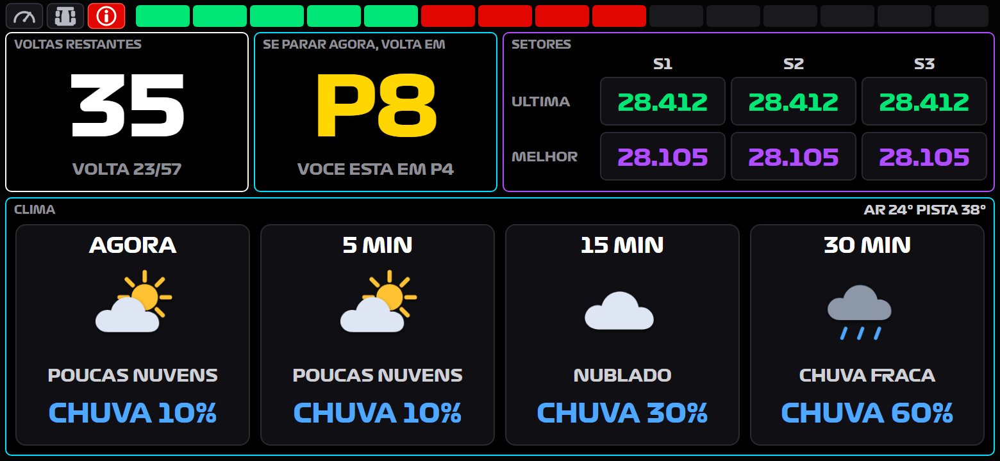

- **Voltas restantes**, grande, com a volta atual embaixo.
- **Se parar agora, volta em:** a posição em que você sairia do box se parasse nesta volta, calculada pelo jogo:
  - verde: você perde no máximo 1 posição;
  - amarelo: perde até 4;
  - vermelho: perde mais que isso.
- **Setores (S1, S2, S3):** os tempos da última volta (verde quando bateu o seu melhor, amarelo quando foi mais lento) e o seu melhor de cada setor (roxo).
- **Clima:** agora e a previsão para daqui a 5, 15 e 30 minutos, com ícone, condição e **% de chuva**, mais as temperaturas do ar e da pista.

### Menu
No canto de cima à esquerda tem **3 botões**: **Corrida**, **Carro** e **Info**. É só tocar para trocar de tela. O botão da tela atual fica vermelho.

### Bandeiras e Safety Car (em todas as telas)
O aviso **surge rápido por cima da dash** e some depois de 4 segundos. A bandeira vermelha fica na tela até acabar.
- **Bandeira vermelha** e **bandeira amarela** tomam a **tela inteira**. A amarela mostra o setor.
- **Safety Car, VSC, azul, verde e volta de formação** aparecem num **painel grande** no meio da tela.

| | |
|---|---|
| **Bandeira vermelha**<br>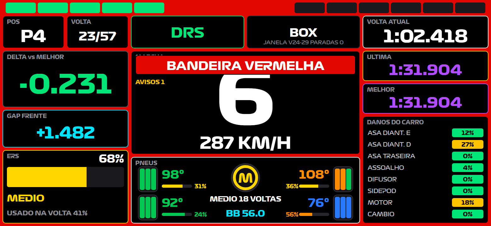 | **Bandeira amarela**<br>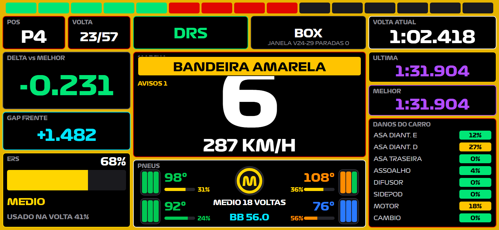 |
| **Safety Car**<br> | **Virtual Safety Car**<br>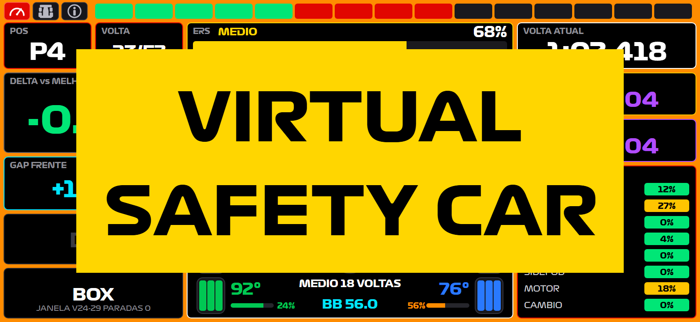 |
| **Bandeira azul**<br> | **Bandeira verde**<br>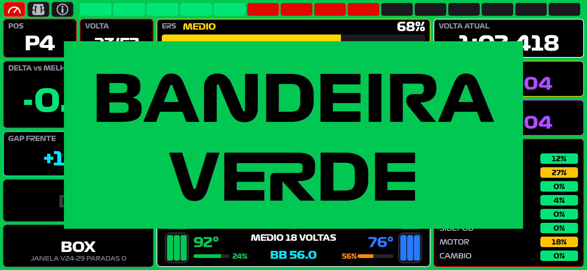 |
| **Volta de formação** (roxo)<br>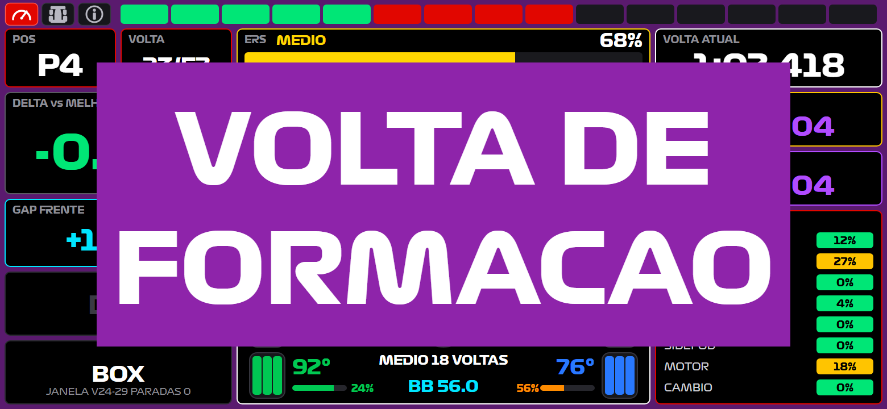 | |

## Todos os modos

| | |
|---|---|
| **Corrida normal**<br> | **Entrada dos box**<br> |
| **Limitador, DRS aberto, penalidade e volta invalidada**<br>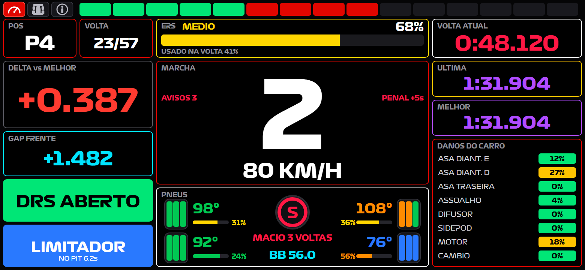 | **Bateria baixa**<br> |
| **DRS aceso + ERS em ultrapassagem + hora de trocar**<br>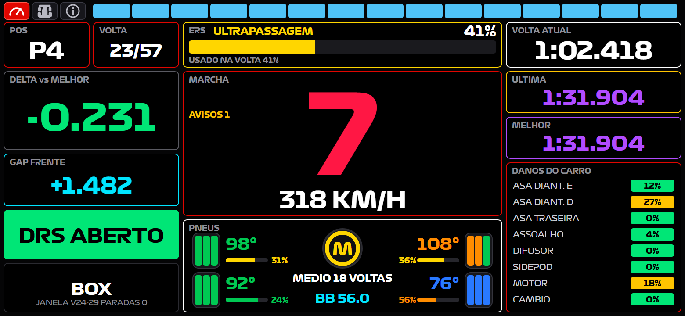 | **Tela do carro**<br> |
| **Marcha subindo** (animação)<br>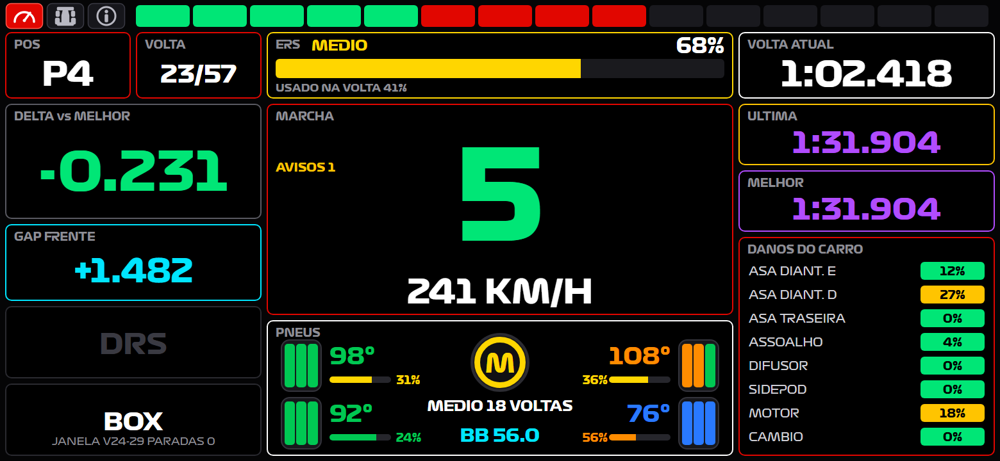 | **Marcha reduzindo** (animação)<br>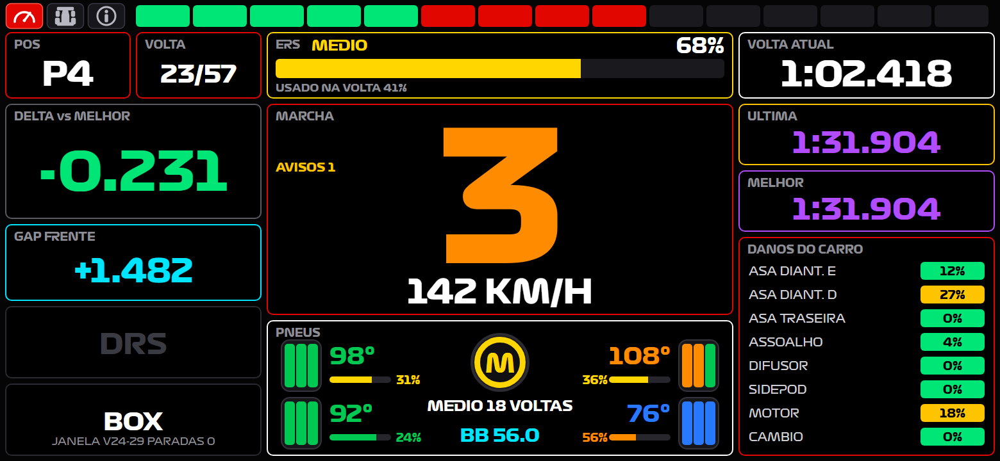 |

> As imagens são prévias estáticas. No jogo, os avisos e a marcha são animados.

## Como instalar

1. **No F1 25:** abra Configurações → Telemetria e deixe assim:
   - Telemetria UDP: **Ligada**
   - IP: `127.0.0.1`
   - Porta: `20777`
   - Formato UDP: **2025**
   - Taxa de envio: **60 Hz**
2. **No SimHub:** escolha o jogo **F1 25**.
3. Dê dois cliques em `F1 25 - Rafa Pro.simhubdash` para importar.
4. **No iPhone:** abra `http://IP-DO-SEU-PC:8888` no Safari, na mesma rede Wi-Fi, e deixe o celular deitado.
   - Dica: use Compartilhar → **Adicionar à Tela de Início** para abrir em tela cheia.

### Trocar de tela
- **No iPhone (ou em qualquer tela de toque):** toque nos ícones do menu no canto de cima.
- **No volante:** no SimHub, vá em **Controls and events**, crie um mapeamento com a ação do Dash Studio de **próxima tela** e escolha um botão.

## Personalizar

A dash é gerada pelo script [`gerar_dash.ps1`](gerar_dash.ps1). Lá dá para mudar cores, posições e textos. Depois é só rodar:

```powershell
powershell -ExecutionPolicy Bypass -File gerar_dash.ps1
```

O script instala a dash na pasta do SimHub e gera o `.simhubdash` de novo.

O **desenho do carro** da tela 2 é original e fica em [`ferramentas/carro.html`](ferramentas/carro.html), em SVG, com cada peça separada. Se você mudar o desenho, gere as imagens de novo antes de rodar o `gerar_dash.ps1`:

```powershell
powershell -ExecutionPolicy Bypass -File ferramentas\gerar_carro.ps1
```

Esse script cria a pasta [`carro/`](carro) com todas as imagens da dash: cada peça do carro em 4 cores (verde, amarelo, laranja e vermelho), os ícones de clima ([`ferramentas/clima.html`](ferramentas/clima.html)) e os botões do menu ([`ferramentas/menu.html`](ferramentas/menu.html)). A dash troca a imagem de cada peça conforme o dano.

As imagens de prévia são geradas por [`ferramentas/render_preview.ps1`](ferramentas/render_preview.ps1), que usa o Microsoft Edge em modo headless.

## Observações

- As cores e os textos dependem dos dados que o F1 25 manda pela telemetria. Se algum campo ficar vazio, abra uma issue.
- Usa as fontes de F1 que já vêm com o SimHub.
- Projeto de fã, sem ligação com a Formula 1, a EA ou a Codemasters.
